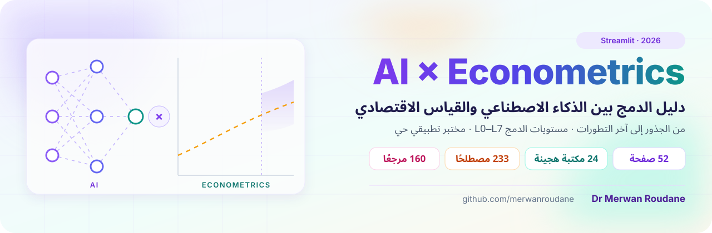

<p align="center">
  
</p>

<p align="center">
  <a href="https://ecohybrid.streamlit.app/"></a>
</p>

<p align="center">
  
  
  
  
  <a href="https://pypi.org/user/merwan.roudane/"></a>
</p>

# AI × Econometrics — دليل الدمج بين الذكاء الاصطناعي والقياس الاقتصادي

منصة Streamlit عربية (من اليمين إلى اليسار، شريط جانبي على اليمين) تقدم محاضرة نظرية شاملة حول الدمج بين الذكاء الاصطناعي والقياس الاقتصادي:
من الجذور قبل الدمج إلى آخر التطورات في أكتوبر 2026، مع المصطلحات الإنجليزية، ومخططات Mermaid، ورسوم متحركة بزر ▶ Play، ومختبرات محاكاة تفاعلية.

إعداد وتطوير: **د. مروان رودان (Dr Merwan Roudane)** — <https://github.com/merwanroudane>

**جرّب المنصة مباشرة:** <https://ecohybrid.streamlit.app/>

## التشغيل

```bash
pip install -r requirements.txt
streamlit run streamlit_app.py
```

للمختبر التطبيقي (تشغيل مكتبات المؤلف الـ 24 على بياناتك):

```bash
pip install -r requirements-lab.txt
```

## البنية

| القسم | الصفحات |
|---|---|
| المدخل | الرئيسية وخريطة الدليل |
| الجذور والتاريخ | ما قبل الدمج · الخط الزمني وموجات الدمج · ثورة البيانات الضخمة وغير المهيكلة |
| الأسس النظرية | الثقافتان · مفاهيم تعلم الآلة · الخوارزميات بعين قياسية |
| المفهوم والمستويات والمنهج | مفهوم الدمج · مستويات الدمج L0–L7 · كيف ندمج؟ |
| المنهجيات والتطبيقات | تعلم الآلة السببي · الأثر غير المتجانس · التنبؤ · النص والصورة · الهيكلي · الذكاء التوليدي · القياس لخدمة الذكاء الاصطناعي |
| الخوارزميات الهجينة المتخصصة | هجين السلاسل الزمنية · هجين البانل والتصاميم السببية · التعلم المعزز · الشبكات الموجّهة بالنظرية · ثورة القياس · النماذج التأسيسية والرمزية |
| المختبر التطبيقي لمكتبات المؤلف | مدير البيانات · DML والسببية · البانل · سببية غرانجر · VAR/ARDL · التقلب والتنبؤ · النواة والموجات والكمّيات |
| التقييم والقرار | متى ندمج؟ · الانتقادات · الآفاق · التقييم وقائمة التحقق |
| المصادر والأدوات | الأدوات والبرمجيات · مسرد المصطلحات · المراجع والكتب |

- `streamlit_app.py` — نقطة الدخول والتنقل.
- `app_pages/` — صفحات المحاضرة (كل صفحة مقسمة إلى صفحات جزئية/تبويبات).
- `core/ui.py` — التنسيق: RTL، البطاقات الملونة، الأزرار المتحركة لـ Plotly.
- `core/lab/` — المختبر التطبيقي: `base.py` (الأدوار والخيارات ومنفّذ التشغيل)، `specs_*.py` (محوّل لكل مكتبة: بيانات تجريبية، تشغيل، شرح نظري وتطبيقي)، `page.py` (واجهة المختبر ومدير البيانات).
- `core/glossary_data.py` و `core/refs_data.py` و `core/timeline_data.py` — بيانات المسرد والمراجع والخط الزمني.
- `.streamlit/config.toml` — السمة الفاتحة والخطوط والألوان.

روابط DOI في صفحة المراجع جرى التحقق من وجودها ومطابقة عناوينها عبر doi.org و Crossref.
المحاكاة والأمثلة الرقمية في المختبرات تعليمية ومولّدة صناعيًا ما لم يُذكر غير ذلك.
